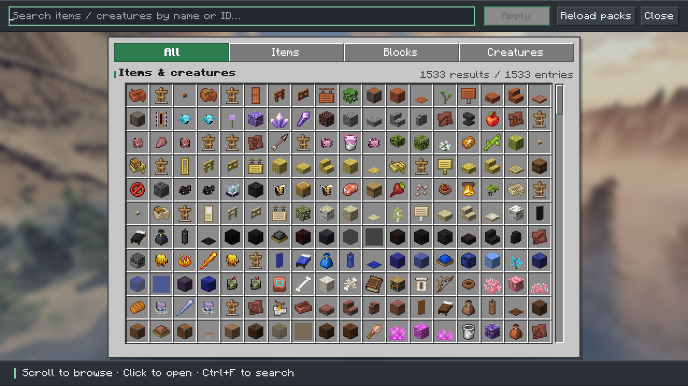
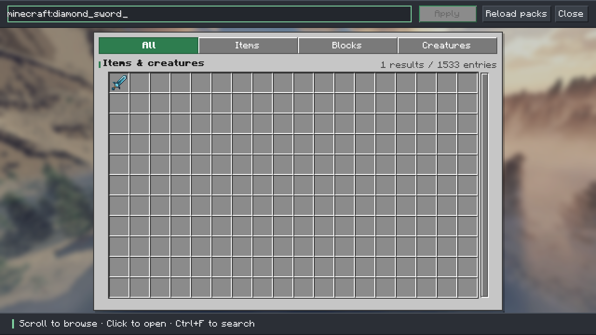
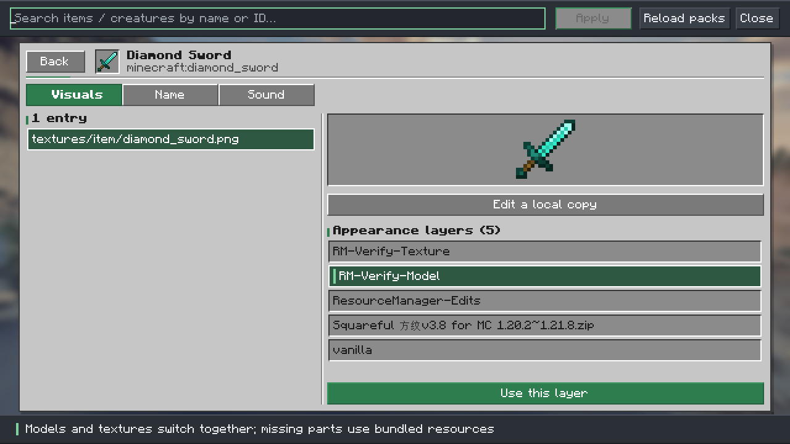
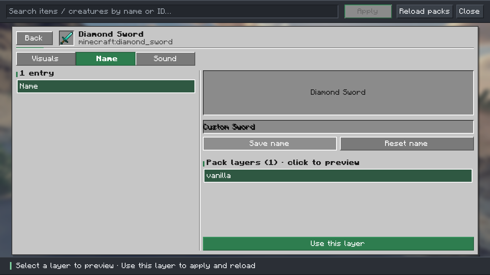
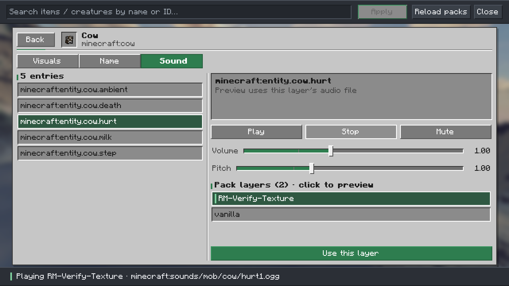
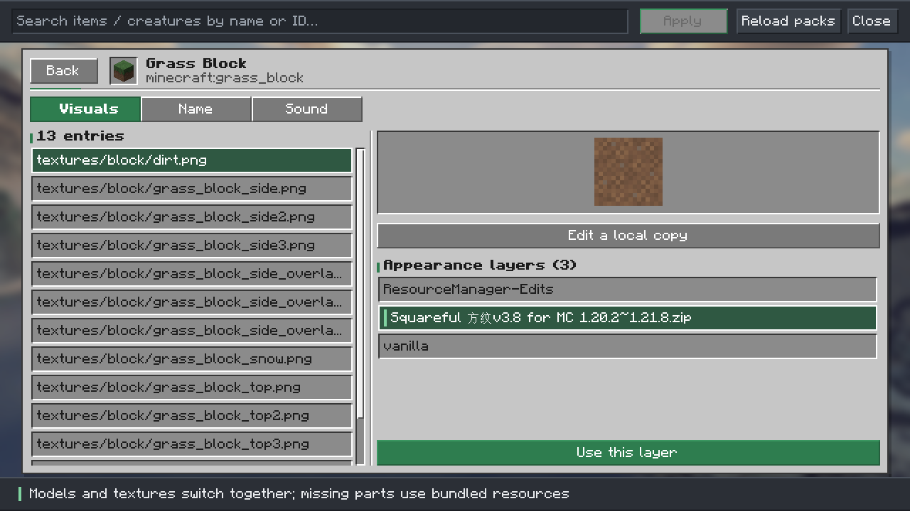
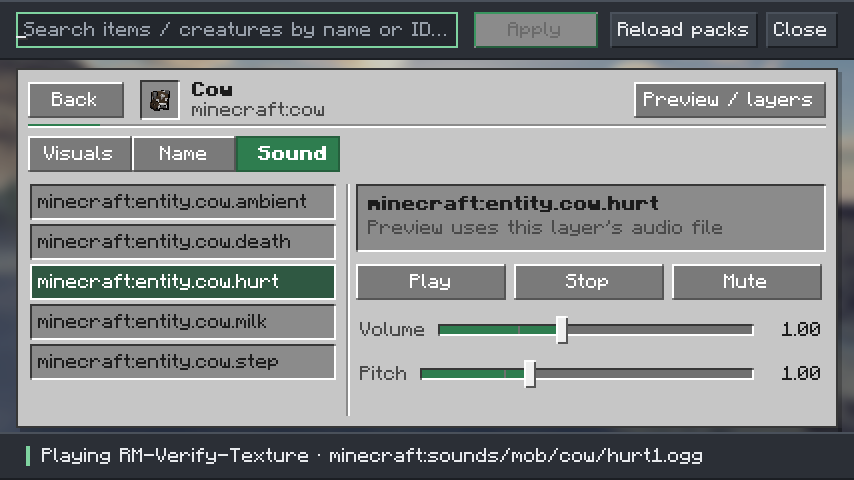

# ResourceManager

**A client-side resource editor for Minecraft 1.21.4 (Fabric), laid out like a vanilla inventory.**

Press **F8**, search for an item, block or creature by name or ID, and click its slot. Its textures, its
display name and its sounds are one click away. Every choice is previewed before it is applied, and the
resource packs you downloaded are never rewritten.



## Three tasks per object

**Visuals.** The real textures of the object, decoded from the pack you pick: every face of a block, the
layers of a piece of equipment, the sprite of a plain item. A model, item definition, block state or
animation metadata still travels with the texture, but those files stay off the list. One pack is chosen
for the object's whole appearance, and parts that pack does not ship fall back to bundled assets instead
of to another directory or ZIP pack.

**Name.** The names the loaded packs give that object. Type a new one and the tooltip, hotbar and chat
text change immediately; **Reset name** puts the original back. Only that object's translation key is
overridden — no language file is edited.

**Sound.** The events that belong to the object. Choose a pack layer, **Play** to hear exactly the bytes
that layer ships, **Stop** to release the player, **Mute** to silence the event in the game, and set volume (0–16) and pitch (0.5–2), which are multiplied into real in-game playback. The
pitch range is exactly the one vanilla lets through; volume is a multiplier applied before vanilla clamps
the total to 1, so its top end lifts events a pack registered quieter than full volume. Each event keeps
its own layer, independently of the visual layer and of the other events.

## Pack layers

Selecting an object lists the packs that actually provide part of it. Clicking a row only previews;
**Use this layer** stages the choice; the chrome **Apply (N)** button reloads once for the whole batch. The layer the game is using now
carries a green bar at its left edge.

- Visuals switch as a whole, so a model can never end up drawn with another pack's texture.
- Sounds switch per event, so retuning one event does not rewrite the rest of a `sounds.json`.
- Objects that share a texture or model ID stay consistent: a conflicting choice is reconciled for the
  whole group instead of splitting it.

When the window is too short to show the preview and the layer list together, the detail view folds into
a compact layout with a **Preview / layers** switch.

## Local edits

**Edit a local copy** copies the object's current visual dependencies into a separate
`ResourceManager-Edits` pack and opens the selected texture in your system's associated editor. Save
there, come back and press **Reload packs** or **F5**. Files you have already touched are kept, and the
original pack — directory or ZIP — is never modified.

## Screenshots

| | |
| --- | --- |
|  |  |
| Searching by ID narrows the inventory to a single slot | Visuals: the texture, and the packs that provide it |
|  |  |
| Name: one field, applied to the object's translation key | Sound: events, layers, playback and tuning |
|  |  |
| A block lists its real faces — `top`, `side` and the rest | In a short window the detail view goes compact |

## Controls

| Input | Action |
| --- | --- |
| F8 | Open or close ResourceManager (rebindable in *Options → Controls*) |
| Ctrl+F | Focus the search box |
| Click / Enter | Open the highlighted slot |
| Arrow keys | Move the inventory selection while a text field is not focused |
| Mouse wheel | Scroll the inventory or a list; fine-tune a slider |
| Escape | Leave the detail view; in the inventory, clear the search, then close |
| F5 | Reload resource packs |

## Install

Java 21, Fabric Loader and Fabric API for Minecraft 1.21.4. Drop the built JAR into your instance's
`mods` folder. Client side only: it changes what your client loads and draws, and sends nothing to the
server. Choices are kept in `config/resourcemanager.json`.

## What it can and cannot see

Discovery walks item definitions, models, block states, equipment definitions, block material sounds and
the known entity texture conventions, and lists only files that exist in the loaded packs. References a
third-party renderer builds in Java at runtime cannot be enumerated. The texture view is a preview, not a
3D editor, and a sound preview does not reproduce distance, randomness or the situation a sound would
play in.

## Build and verification

`gradlew.bat --offline build` compiles against locally cached dependencies. To drive the real client
widgets and the live resource providers:

```powershell
$env:RESOURCEMANAGER_INVENTORY_VERIFY='1'
.\gradlew.bat --offline runClient
```

The last run reported **55 PASS / 0 FAIL**: [docs/inventory-verify-report.txt](docs/inventory-verify-report.txt).

Deeper reading: [usage and verification](docs/INVENTORY.md) · [architecture](docs/ARCHITECTURE.md) · [中文说明](README.zh_cn.md)

MIT licence: [LICENSE](LICENSE).
