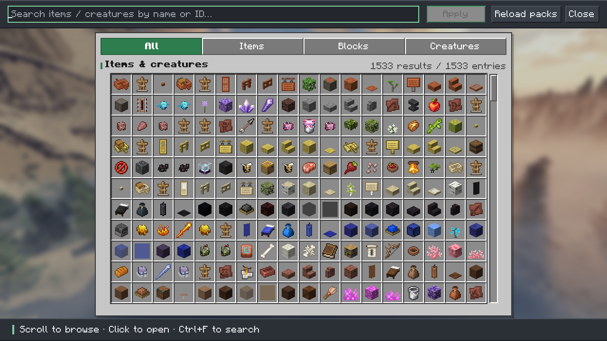
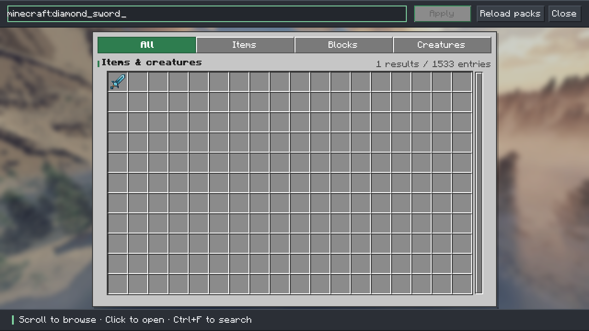
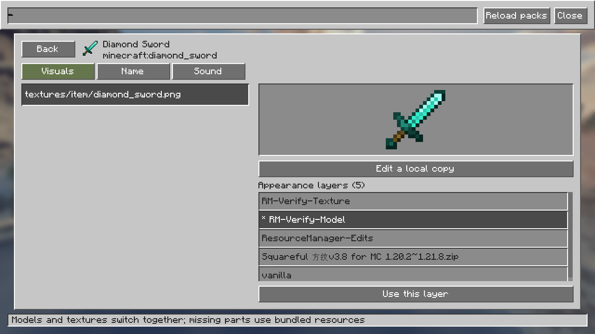
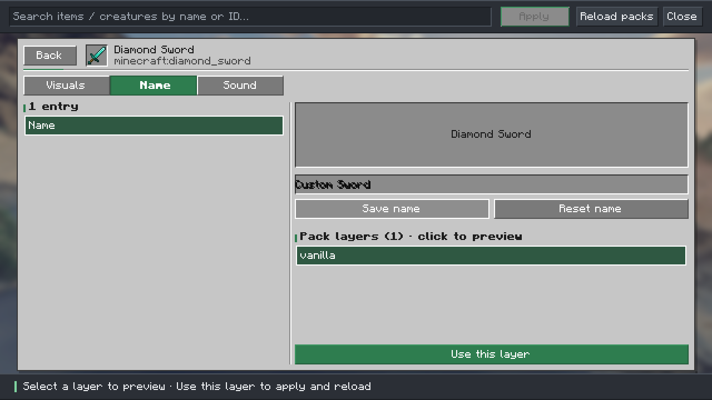
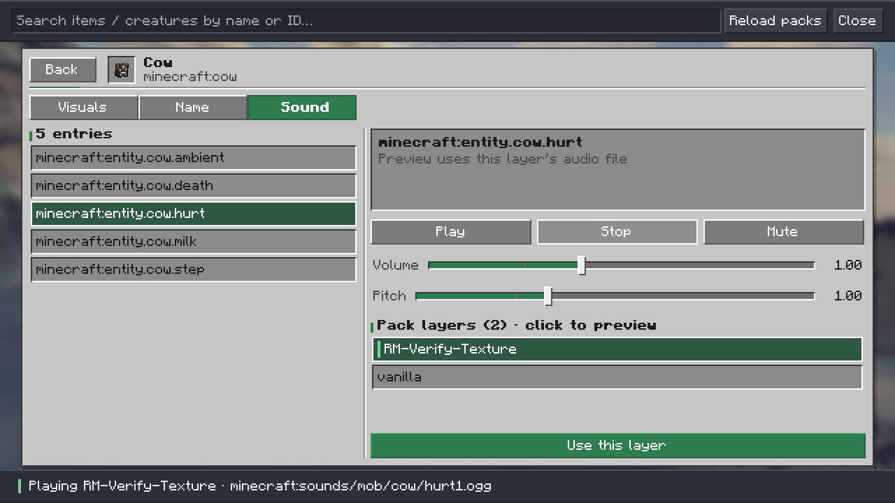
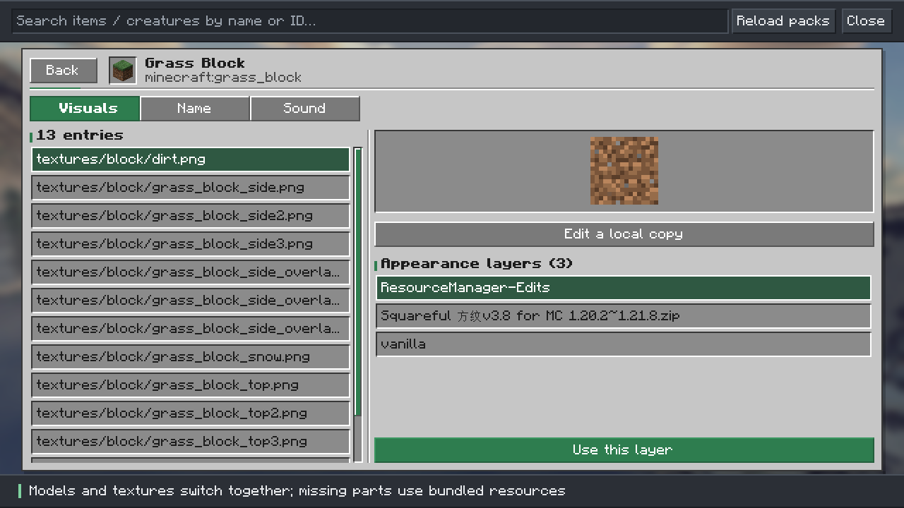
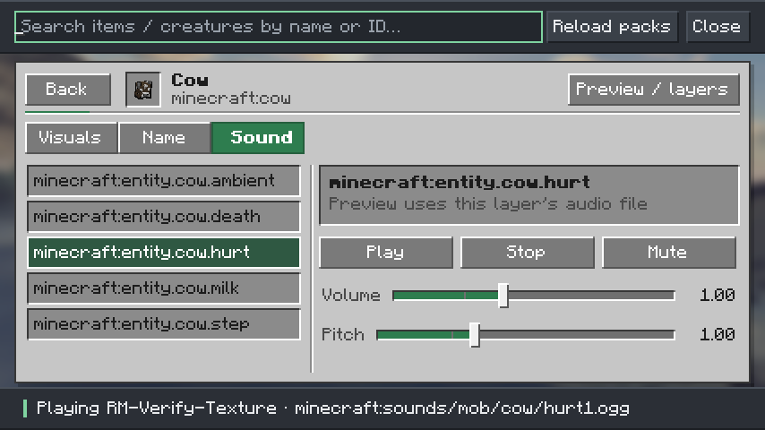

# ResourceManager

**Minecraft 1.21.4 / Fabric 纯客户端资源编辑模组，界面就是一个原版物品栏。**

按 **F8**，用名称或 ID 搜索物品、方块或生物，点击槽位进入详情。贴图、显示名称、音效都只有一步之遥。
每次选择都先预览、再应用，下载来的资源包不会被改写。



## 每个对象的三件事

**外观。** 从所选资源包里真正解出这个对象的贴图：方块每个面、装备各层、普通物品的图标。模型、物品定义、
方块状态和动画元数据依然随贴图一起跟随，但不作为列表条目出现。一个对象只选一个外观包；该包缺少的部分回退到
内置资源，而不会混入其他目录包或 ZIP 包。

**名称。** 查看各资源包给这个对象的名字。输入新名称，提示框、快捷栏和聊天里的文本立即变化；**恢复名称**
还原原样。只覆盖这个对象的翻译键，不改写任何语言文件。

**音效。** 属于这个对象的事件。选择资源包层后 **试听** 播放该层真正的音频字节，**停止** 释放播放器；
音量 0–8、音高 0.25–4 会乘进真实游戏播放。每个事件各自保留一层，与外观层、与其他事件都互不影响。

## 资源包层

进入详情会列出真正提供了这个对象某个部分的资源包。点击一行只是预览，**游戏使用此层** 才应用并重载资源。
当前生效的层前面有 `*`。

- 外观整组切换，模型不会配到另一个包的贴图。
- 音效按事件切换，调一个事件不会改写整份 `sounds.json`。
- 共用同一贴图或模型 ID 的对象保持一致：冲突的选择会整组统一，而不是把一组拆成两种来源。

窗口太矮、放不下预览和层列表时，详情切换为紧凑布局，用 **预览 / 覆盖层** 按钮切换。

## 本地编辑

**编辑本地副本** 会把当前外观依赖复制到独立的 `ResourceManager-Edits` 资源包，并用系统关联编辑器打开
所选贴图。保存后回到游戏按 **重载资源包** 或 **F5**。已编辑过的文件不会被重新覆盖，原目录包和 ZIP 包
始终不被修改。

## 截图

| | |
| --- | --- |
|  |  |
| 用 ID 搜索，物品栏只剩一个槽位 | 外观：贴图预览与提供它的资源包 |
|  |  |
| 名称：一个输入框，作用于该对象的翻译键 | 音效：事件、资源包层、试听与调音 |
|  |  |
| 方块会列出真正用到的 `top`、`side` 等各面 | 窗口较矮时详情切换为紧凑布局 |

## 操作

| 操作 | 效果 |
| --- | --- |
| F8 | 打开或关闭 ResourceManager（可在 *选项 → 控制* 里改键） |
| Ctrl+F | 聚焦搜索框 |
| 单击 / Enter | 打开高亮槽位 |
| 方向键 | 文本框未聚焦时移动物品栏选择 |
| 滚轮 | 滚动物品栏或列表；在滑条上微调 |
| Escape | 详情返回；物品栏先清空搜索，再关闭 |
| F5 | 重载资源包 |

## 安装

需要 Java 21、对应 Minecraft 1.21.4 的 Fabric Loader 与 Fabric API。将构建的 JAR 放入实例的 `mods`
目录即可。纯客户端：只改变本机加载和绘制的内容，不向服务器发送任何数据；选择保存在
`config/resourcemanager.json`。

## 能发现什么，不能保证什么

关联依据物品定义、模型、方块状态、装备定义、方块材质音效和已知的实体纹理约定，并且只列出已加载资源包中真实
存在的文件。第三方 renderer 在 Java 运行时拼出来的引用无法静态枚举。贴图视图是预览，不是三维编辑器；
音效试听也不等同于游戏里带距离与随机性的实际播放。

## 构建与验证

`gradlew.bat --offline build` 使用本机缓存依赖构建。要驱动真实客户端控件与实际资源提供者：

```powershell
$env:RESOURCEMANAGER_INVENTORY_VERIFY='1'
.\gradlew.bat --offline runClient
```

最近一轮结果为 **43 PASS / 0 FAIL**：[docs/inventory-verify-report.txt](docs/inventory-verify-report.txt)。

继续阅读：[使用与验证](docs/INVENTORY.md) · [架构说明](docs/ARCHITECTURE.md) · [English](README.md)

MIT 许可证：[LICENSE](LICENSE)。
