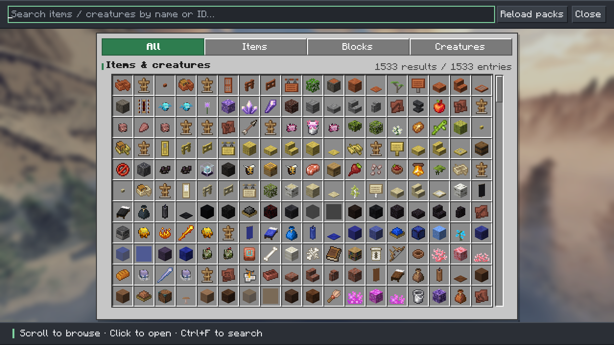
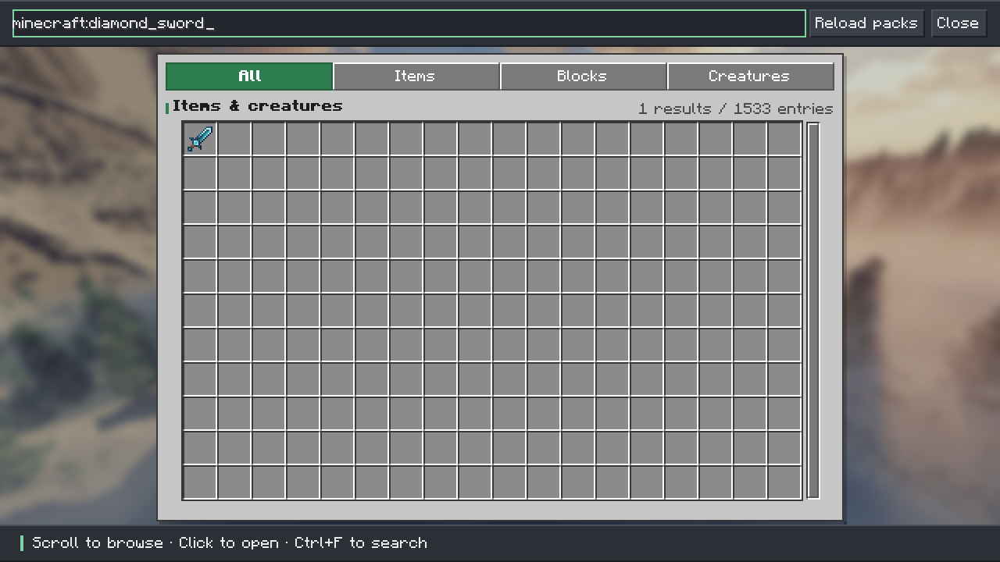
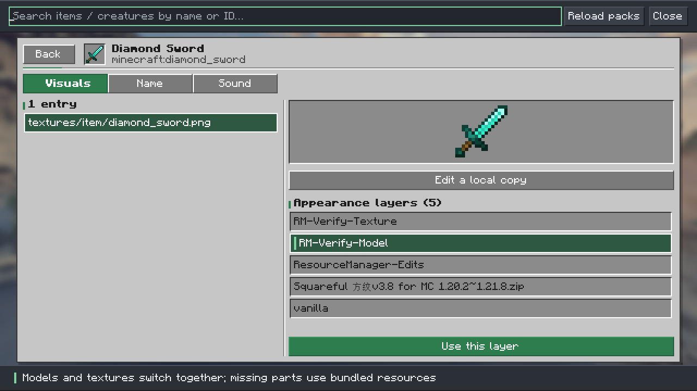
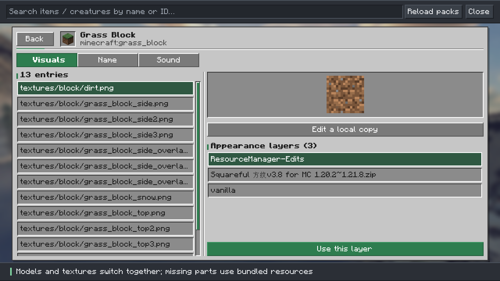
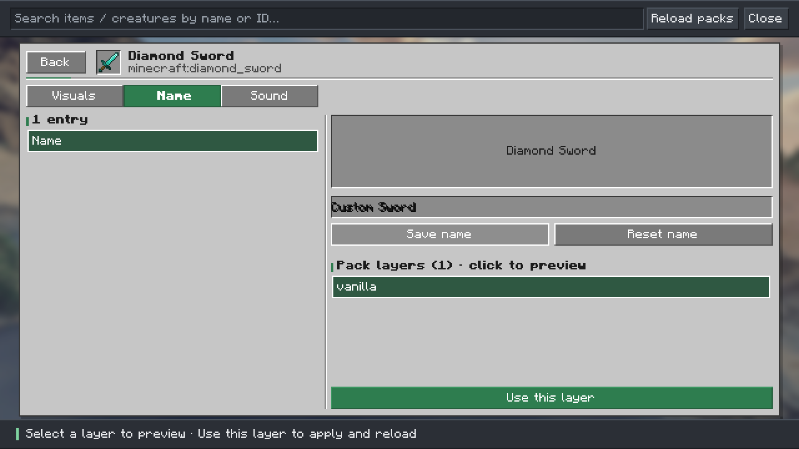
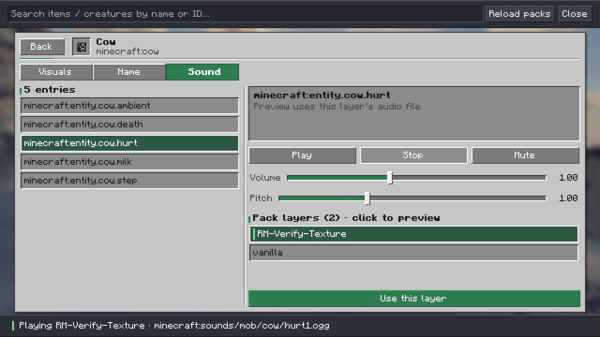
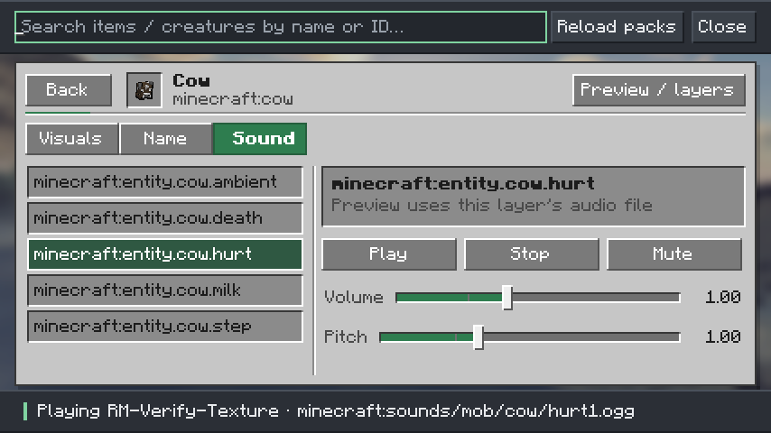

# 物品栏入口：使用与验证

ResourceManager 在 Minecraft 1.21.4 Fabric 客户端中提供原生物品栏入口：从真实注册的物品、方块和实体出发，
把它们的贴图、名称和音效收进同一个对象视图。本页记录当前代码与实际客户端报告。

界面分两层表面：顶部工具栏与底部状态栏是深色外框，内容面板保持原版浅灰容器与一像素明暗硬边；绿色只用于选中的
页签、填绿的主操作按钮、滑块行程、键盘光标格和区块标题前的短刻度。视觉规范见 [DESIGN.md](../DESIGN.md)。

## 打开与浏览

1. 按 F8 打开 Resource Manager。顶部是搜索框、重载与关闭；底部是状态栏，其余区域都属于物品栏。
2. 用 **全部 / 物品 / 方块 / 生物** 切分类。格子里画的是真实 ItemStack：方块用对应方块物品；生物用刷怪蛋，
   没有刷怪蛋的实体使用盔甲架图标，它不是生物的三维预览。
3. 搜索框匹配显示名称、翻译键和命名空间 ID（如 `minecraft:diamond_sword`），中英文都可用，多个关键词按
   全部命中过滤。Ctrl+F 聚焦搜索框；聚焦时方向键仍是文本光标。
4. 滚轮按行滚动，也可以拖动右侧滚动槽。文本框未聚焦时方向键移动高亮，Enter 打开高亮格，单击也可以。
   悬停显示“名称 · ID”。没有匹配时格区显示空状态提示。格区上方左侧是当前分类的标题，右侧是“结果 / 总数”。

容器最宽 440 GUI px，每格 22 GUI px（图标 16），最多 18 列；实际显示尺寸随 GUI Scale 变化。

## 详情：外观 / 名称 / 音效

打开对象后，上方是加粗的对象名、图标和弱化的 ID，下方一条分隔线；左侧是该对象的资源列表（标题显示条数），
中间一条竖分隔线，右侧是预览区和资源包层列表。三个页签等分左列宽度，只切换列表内容：

| 任务 | 列表内容 | 右侧控制 |
| --- | --- | --- |
| 外观 | 只列 PNG 贴图，模型、物品定义、方块状态、装备定义和动画元数据只跟随、不显示 | 贴图预览、层列表、**编辑本地副本** |
| 名称 | 只有一条“名称”条目 | 名称输入框、**保存名称**、**恢复名称** |
| 音效 | 只列 `sounds.json` 中的事件，不显示 JSON 内容和重复的 OGG 行 | 试听 / 停止 / 静音、音量、音高、层列表 |

在详情里输入搜索词会过滤当前对象的条目，不会重新搜索其他对象；进入详情时会保存并清空原查询，返回时恢复。
**返回** 或 Escape 回到网格。

## 资源包层

层列表只列出真正提供了这个对象某一部分的资源包，当前游戏正在使用的层在行首有一条绿色竖条。

- **点击一行只预览**：选中行加深并加 1px 白框，更新贴图、文本或音频的预览来源，不改变游戏正在用的来源。
- **游戏使用此层** 才应用：写入配置并立刻重载资源包。
- 外观整组切换：一个对象的所有外观文件（贴图、模型、方块状态、装备定义、动画元数据）只允许来自选中的包；
  该包缺少的文件使用内置来源，不混用其他目录/ZIP 包。
- 音效按事件切换：每个事件单独记录来源，互不影响，也不会整份替换 `sounds.json`。
- 共用同一资源 ID 的对象保持组内一致：一处冲突会把已配置的同组对象一起改到同一个来源。

## 名称

选中“名称”条目后，输入框里是这个对象当前的显示名。**保存名称** 写入该翻译键的文本覆盖，提示框、快捷栏和
聊天文本立即更新；**恢复名称** 清除覆盖。右侧预览显示所选资源包里该键的原始值，覆盖不会改写语言文件本身。

## 音效

选择事件后，先选好想检查的资源包层再 **试听**；**停止** 释放播放器，切换条目、返回或离开界面也会停止。
试听读取所选层的实际音频文件，缺文件时按当前有效来源取音频。

音量范围 0–16，音高范围 0.5–2，1 为默认值；数值乘进真实游戏播放，由 `AbstractSoundInstance` 的
`getVolume` / `getPitch` 注入。音高范围就是原版 `SoundEngine` 夹取的范围，滑杆两端都能听到；音量是
原版把总音量夹到 1 之前的倍数，所以高端只对包内登记得比满音量更轻的事件有效，音量 0 即静音。
滑杆的行程按曲线分配，0–1 这一段占去一半左右，常用的低倍率更容易拖准。

**静音** 把该事件的音量写成 0：原版 `SoundEngine` 遇到 0 音量会直接跳过这次播放，连通道都不创建。
按下后按钮变成 **取消静音**，再点一次回到静音前的音量；静音期间直接拖音量滑杆也会取消静音。
已经在播放的一次性音效不会被追溯改写，从下一次播放起生效。
这一预览不等同于游戏里带随机性、距离和空间效果的实际声音。

## 本地编辑

选中资源和包层后点 **编辑本地副本**：当前外观依赖被完整复制到游戏目录下的
`resourcepacks/ResourceManager-Edits/assets/<namespace>/<resource-path>`，并用系统关联编辑器打开该贴图。
保存后回到游戏点 **重载资源包** 或按 F5。已经存在的编辑副本会保留内容，不会被原包重新覆盖；原目录包和 ZIP
包始终不被改写。系统需要已关联能编辑该扩展名的应用；打开副本也不会自动监听编辑器的保存。

## 紧凑布局

检视区高度不够时，详情切换为紧凑布局：**预览 / 覆盖层** 按钮在两套控件之间切换——预览态放名称输入、
试听、滑条或文本，覆盖层态放资源包层列表和应用按钮。客户端验证用例使用 427×240 GUI px 的窗口检查控件边界。

## 关联边界

[SubjectCatalog.java](../src/client/java/com/abelian/client/catalog/SubjectCatalog.java) 的关联建立在注册表与已加载
资源索引上：

- 读取物品定义、模型、方块状态 JSON，并递归走 parent / model、texture / textures 等实际引用，只列出索引中存在
  的文件。装备按 Minecraft 1.21.4 EQUIPPABLE.assetId 读取 equipment JSON 的 layers 纹理，并关联 cameraOverlay。
- 方块音效除名称前缀外，还读取默认方块状态 SoundType 的 break / step / place / hit / fall 共用材质事件。
- 生物纹理按命名实体文件与变体目录匹配，包含已实现的原版别名映射，另有箱子、床与盔甲等目录规则；目录匹配可能
  列出同一目录的多个变体，不代表它们都用于当前某个实体实例。
- 语言资源按是否含有该对象翻译键关联。最终实际生效内容仍由所选层与游戏资源包顺序决定。

这些规则无法静态保证发现第三方 renderer 在 Java 或运行时构造的任意引用，也不代表对全部模组资源的覆盖。

## 验证与复现

验证入口使用环境变量 RESOURCEMANAGER_INVENTORY_VERIFY=1 与 `gradlew.bat --offline runClient`：

	$env:RESOURCEMANAGER_INVENTORY_VERIFY = '1'
	.\gradlew.bat --offline runClient

最近一轮真实客户端输出 [inventory-verify-report.txt](inventory-verify-report.txt) 为 **55 PASS、0 FAIL**，
覆盖以下流程：

| 范围 | 报告中的证据 |
| --- | --- |
| 入口与搜索 | 真实注册表条目、中文物品搜索、命名空间 ID、聚焦搜索框的方向键 |
| 打开与返回 | 单击槽位打开详情、选中层后应用、Escape 返回网格 |
| 形式与引用 | 外观只列 PNG、模型仍在依赖图中、普通物品无方块贴图、方块列出真实各面、装备贴图保留 |
| 预览与修改 | 实际解码贴图、名称更新真实 ItemStack 文本、名称与外观互不影响 |
| 覆盖层 | 多资源包层、贴图来源变为所选包、缺少的模型回退到内置资源、整组切换后来源一致 |
| 声音 | 滑块改动调音、事件列表无重复 OGG、所选层音频解码播放、停止释放播放器、事件来源独立 |
| 本地编辑 | 已存在副本不被覆盖、整组依赖齐全、动画元数据跟随图片、重载后成为实际来源 |
| 紧凑与性能 | 427×240 GUI px 控件边界、紧凑层切换、100 次无变化布局不重复解码预览 |

截图是该环境的记录，不测量硬件 FPS，也不证明第三方资源关系全覆盖或每个系统关联编辑器的保存流程。
